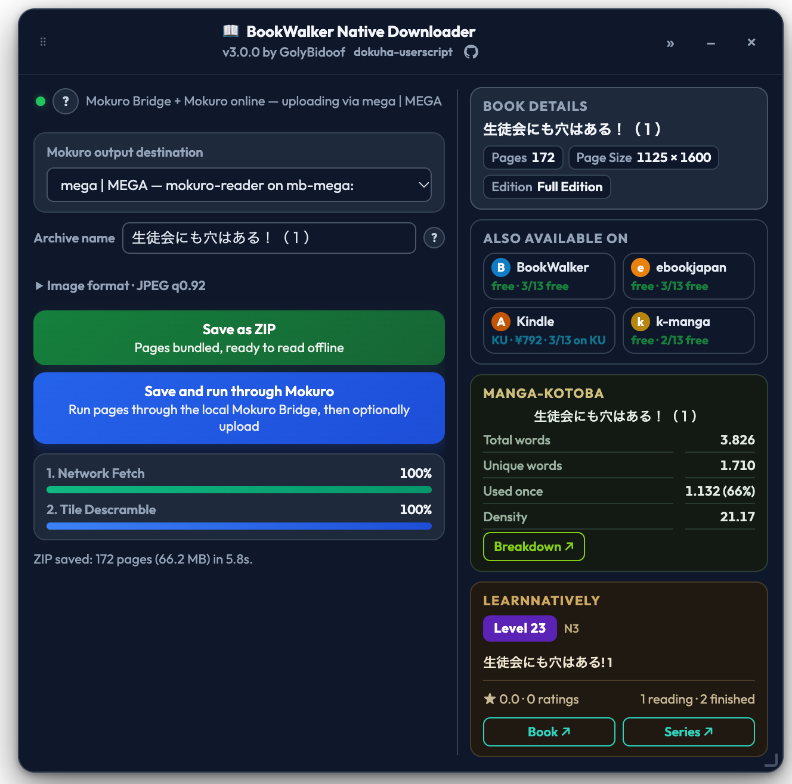
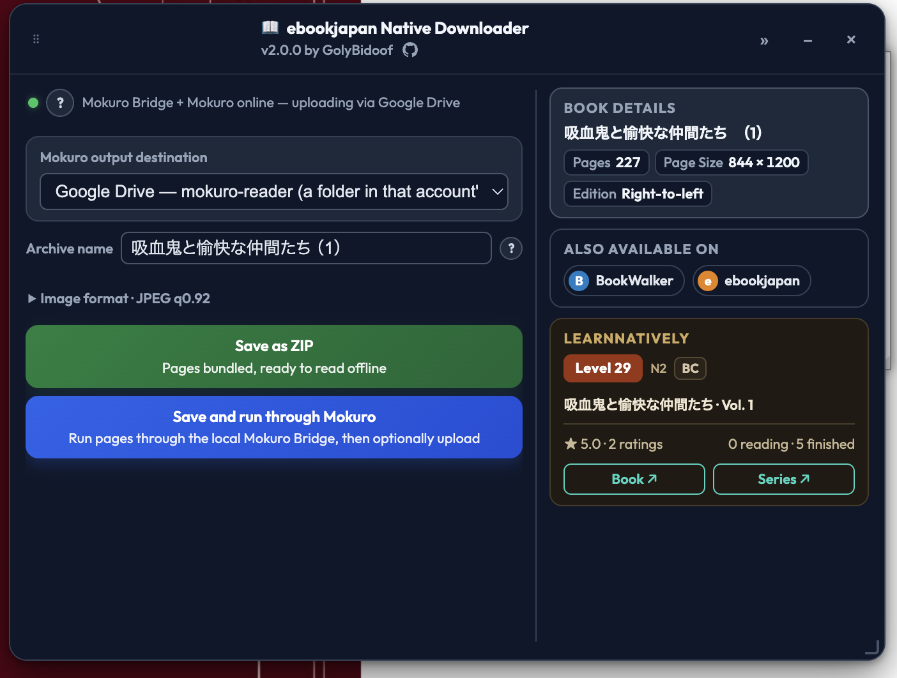
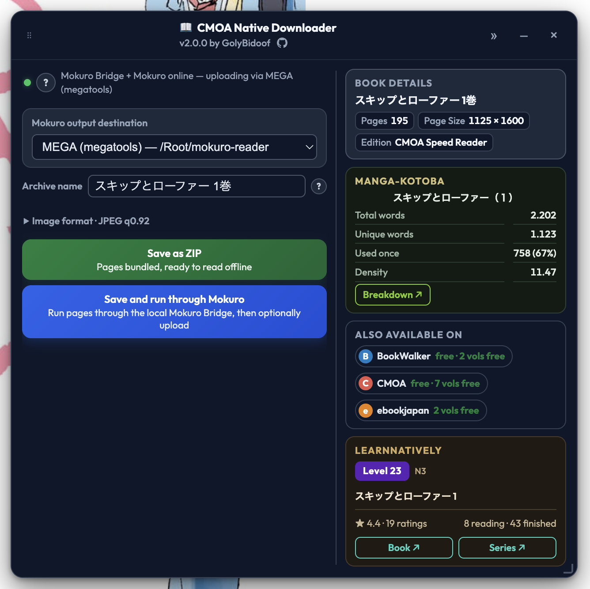
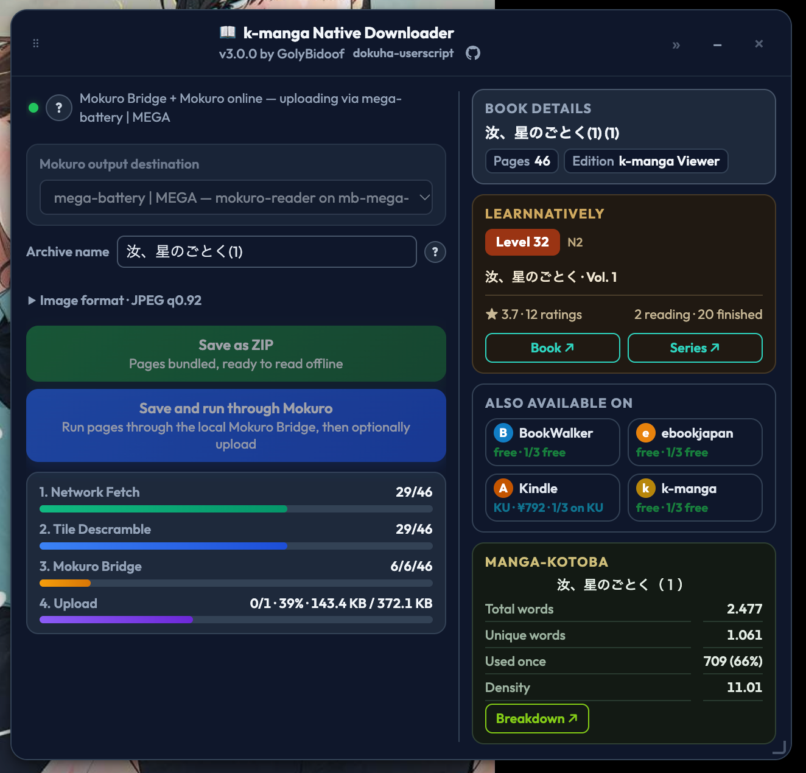
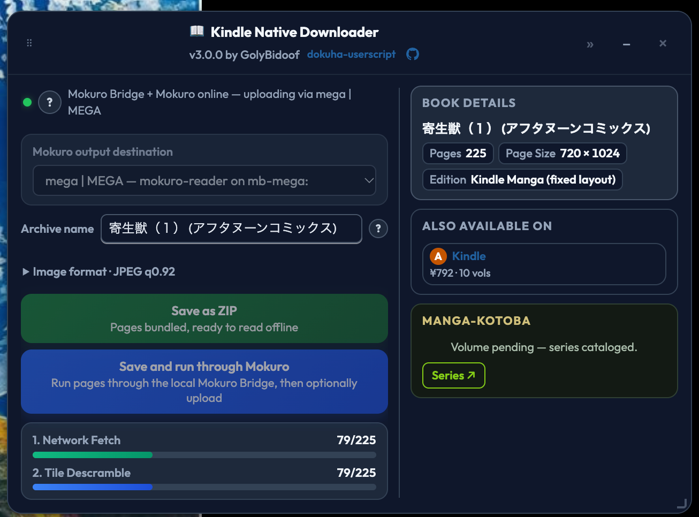

<p align="center"></p>

# 読破 (dokuha-userscript) · v3.0.1

<p align="center"><strong>Archive the volume you already have open, at full resolution.</strong></p>

<p align="center">MIT · Tampermonkey or Violentmonkey</p>

[Quick start](#quick-start) · [Install](#install) · [Screenshots](#screenshots) · [Why people use it](#why-people-use-it) · [Supported stores](#supported-stores) · [How it works](#how-it-works) · [Related tools](#related-tools) · [Documentation](#documentation)

dokuha-userscript is a browser userscript that saves the volume you already have open in BookWalker, CMOA, ebookjapan, the Kindle web manga reader or k-manga. It reads the viewer's own signed CDN URLs, fetches every page file directly, rebuilds each page offline, and gives you a ZIP or a finished Mokuro volume. You never turn a page to capture it.

The name comes from the Japanese word 読破, to read a work through to the end, which is what the script lets you do with a book you can already read online: offline, at full resolution, in your own reader.

## Quick start

1. Install a userscript manager: [Tampermonkey](https://www.tampermonkey.net/) (Chrome, Firefox, Edge) or [Violentmonkey](https://violentmonkey.github.io/).
2. Install the script (see [Install](#install)), then open a volume in any supported reader. The panel appears once the viewer is ready.
3. Choose **Save as ZIP** for a plain archive, or **Save and run through Mokuro** if a local [mokuro-bridge](https://github.com/GolyBidoof/mokuro-bridge) is running, then watch both bars finish.

## Install

Open [`dokuha-userscript.user.js`](dokuha-userscript.user.js) and click **Install**, or install it from [GreasyFork](https://greasyfork.org/en/scripts/597313-dokuha-userscript). Install one script only: the combined build and a single-store build match the same hosts, so running both gives you two panels.

Only need one store? Each store also has its own smaller userscript, carrying the shared core and that one store's code, so it can never pull in another store's protocol. The three older entries are on GreasyFork: [BookWalker Native Downloader](https://greasyfork.org/en/scripts/594508-bookwalker-native-downloader), [CMOA Native Downloader](https://greasyfork.org/en/scripts/597317-cmoa-native-downloader) and [ebookjapan Native Downloader](https://greasyfork.org/en/scripts/597318-ebookjapan-native-downloader). Kindle and k-manga install from this repository: [Kindle Native Downloader](kindle-only.user.js) and [k-manga Native Downloader](kmanga-only.user.js).

Tampermonkey asks for cross-origin access to the stats and store-search hosts. That permission powers only the reading-stat cards and the "also available on" pills; decline it and downloading, OCR and ZIP saving work exactly the same.

## Screenshots

<table align="center">
  <tr>
    <td align="center"><br /><sub>BookWalker: a finished run, 172 pages saved as a ZIP in 5.8 seconds, with the bridge and the reading stats in the panel.</sub></td>
  </tr>
</table>

<table align="center">
  <tr>
    <td align="center"><br /><sub>ebookjapan: the same panel with a Google Drive destination.</sub></td>
    <td align="center"><br /><sub>CMOA: the also-available-on links for every shop that carries the series.</sub></td>
  </tr>
  <tr>
    <td align="center"><br /><sub>k-manga: a 46 page volume in flight, with fetch, descramble, bridge and upload progress.</sub></td>
    <td align="center"><br /><sub>Kindle: a 225 page fixed layout volume mid-run, still fetching.</sub></td>
  </tr>
</table>

## Why people use it

- **Full resolution, not screenshots.** The CDN page file is fetched and rebuilt offline, so the output is the page as published rather than a picture of the page as displayed. JPEG at q0.92 is the default, and WebP, lossless and PNG are also available.
- **One panel, every supported store.** The same controls and output work on BookWalker, CMOA, ebookjapan, Kindle and k-manga, and the combined script picks the store from the page you are on.
- **Only on reader pages.** The scripts match the viewers and nowhere else, so series, title, product and search pages never load the panel, the bridge probe or the traffic capture.
- **Resume, not restart.** Pages are cached as they arrive; an interrupted run continues where it stopped, and the retry only fetches what is missing.
- **Fast on a normal browser profile.** Fetches are spread across every origin a page can open, and rebuilds run across a worker pool, so a browser's six-connections-per-origin limit is not the ceiling.
- **A local mokuro-bridge is a download accelerator too.** A browser gives six connections per origin, so each of the bridge's 48 default ports is six more sockets, up to 288 extra lanes against the 12 the script's own two lanes give it in the hermetic lane test. The gain is largest where a store serves one file per page and smaller on Kindle, which hands pages over in render windows. Run the bridge locally even when you never want OCR or cloud delivery, since the extra fetch lanes are the practical reason and the OCR button comes with the same install.
- **A panel that stays out of the way.** Draggable, resizable and minimisable, it remembers where you put it and does not claim the arrow keys, so the viewer still turns pages normally.
- **Reading stats before you commit.** Natively levels, ratings and reader counts, plus Manga Kotoba vocabulary totals, appear in the panel while you decide.

## Supported stores

| Store | Viewer | What the script reads | Session |
|---|---|---|---|
| BookWalker | `viewer.bookwalker.jp` | signed CDN auth and the page manifest, from the viewer's own traffic | Only for paid or library titles |
| CMOA | `cmoa.jp` reader | page list and BinB descramble geometry | None |
| ebookjapan | `ebookjapan.yahoo.co.jp/viewer/` | the viewer's page endpoints and shuffle geometry | None |
| Kindle | `read.amazon.co.jp/manga/` | render windows and the karamel token | Always |
| k-manga | `comic.k-manga.jp/viewer/` | the session from the viewer URL and page data over the viewer socket | None |

Each store's protocol record sits beside its code in `src/sites/<store>/README.md`, and [docs/architecture.md](docs/architecture.md) explains how the shared pipeline uses it.

## How it works

The script separates what is shared from what a store actually does differently. A store module knows how to read its viewer, how to ask for pages, and how to rebuild one page offline. Everything around that is shared core: the panel, the progress bars, the page cache, the archive writer, the transport lanes, the OCR hand-off and the automation API.

A run moves through five stages:

1. **Capture** the viewer's own state. BookWalker's signed URLs are captured passively from its traffic; the other stores read their viewer's state or embedded data.
2. **Plan** the page list, so the page count and order are known before a single CDN request.
3. **Fetch** every page at full resolution, across the page itself, the userscript manager's background context, a dotted host and an HTTP/2 mirror, with retry ladders for expiring signatures and throttling.
4. **Rebuild** each page offline. Depending on the store that means decrypting an envelope, unshuffling tiles on a canvas, running the viewer's own wasm, or decrypting a page cipher.
5. **Deliver** the pages as a flat ZIP of `page-0001.jpg` and so on, or stream them to a running [mokuro-bridge](https://github.com/GolyBidoof/mokuro-bridge) while capture is still going.

The full design, including the build model, the lane budget, the page cache and the bridge protocol, is in [docs/architecture.md](docs/architecture.md).

## Related tools

Both are optional: this userscript works without either of them.

- **[dokuha-cli](https://github.com/GolyBidoof/dokuha-cli)** is the sister tool in the same dokuha family: a batch downloader for the same stores that runs in Node with no browser. Reach for it when you want a whole series rather than the volume you have open, or when there is no browser session to capture.
- **[mokuro-bridge](https://github.com/GolyBidoof/mokuro-bridge)** is the one companion worth installing even for downloads alone: it is a separate service in the mokuro ecosystem, not part of the dokuha tools, and its local ports are what give this script the extra fetch lanes described above. It also runs mokuro OCR on finished pages and delivers the `.cbz`, `.mokuro`, cover `.webp` and per-series `series.json` that [reader.mokuro.app](https://reader.mokuro.app) reads, to a local folder, MEGA, Google Drive, OneDrive, WebDAV or whichever other destination the bridge is configured for. It interoperates with [mokuro-bunko](https://github.com/Gnathonic/mokuro-bunko), which compiles its own library metadata.

## Documentation

| Document | Answers |
| --- | --- |
| [docs/architecture.md](docs/architecture.md) | how the artifact is built, how a run flows, where the shared code ends and store code begins |
| [src/README.md](src/README.md) | the source layout, the adapter contract, the fragment map and how to add a store |
| [src/sites/bookwalker/README.md](src/sites/bookwalker/README.md), [cmoa](src/sites/cmoa/README.md), [ebookjapan](src/sites/ebookjapan/README.md), [kindle](src/sites/kindle/README.md), [kmanga](src/sites/kmanga/README.md) | each store's protocol record, next to its code |
| [RELEASING.md](RELEASING.md) | the version, the tag, the release branch and the GreasyFork sync |
| [CONTRIBUTING.md](CONTRIBUTING.md) | the two rules, the build invariant and how the suite is run |
| [tests/README.md](tests/README.md) | the hermetic suite, file by file |
| [tests/acceptance/README.md](tests/acceptance/README.md) | the opt-in live-store run and its oracle |
| [docs/greasyfork/](docs/greasyfork/) | the paste-ready listing descriptions for the GreasyFork entries |
| [CHANGELOG.md](CHANGELOG.md) | what changed, version by version |

## Development

```sh
npm install
npm run build        # assemble every artifact from src/
npm run check:build  # fail when a committed artifact no longer matches src/
npm test             # the hermetic suite, 32 files
```

The shipped `.user.js` files are built, never edited by hand: each is the concatenation of the `src/` fragments in manifest order, so a change to the source is what changes the script. The suite runs the artifacts in headless Chrome against local stub servers, plus artifact and protocol checks that need no browser. `npm run test:acceptance` runs the opt-in live-store comparison and `npm run test:bridge` measures the fetch lanes against a throwaway bridge instance.

## Credits and licence

Built by [GolyBidoof](https://github.com/GolyBidoof) with **DeepSeek V4.1 Flash**, an AI coding agent. The agent reverse engineered the stores' protocols, ported the crypto and descramble logic, and iterated against live captures until every step matched.

- [BookWalker](https://bookwalker.jp), [CMOA](https://www.cmoa.jp), [ebookjapan](https://ebookjapan.yahoo.co.jp), [Amazon Kindle](https://read.amazon.co.jp) and [k-manga](https://comic.k-manga.jp), for the services this tool works with. All downloaded content remains subject to their terms of service.
- [Brandon](https://learnnatively.com/user/brandon/), for the difficulty levels, JLPT-band colours, ratings and book metadata shown in the stats card, and [ChristopherFritz](https://community.wanikani.com/u/christopherfritz) for the Manga Kotoba vocabulary statistics.
- [kha-white/mokuro](https://github.com/kha-white/mokuro) and [manga-ocr](https://github.com/kha-white/manga-ocr), the upstream OCR engine and model, with [GolyBidoof/mokuro](https://github.com/GolyBidoof/mokuro) as the batched fork that mokuro-bridge recommends; detection uses [comic-text-detector](https://github.com/dmMaze/comic-text-detector).
- [aaa4xu/bookworm](https://github.com/aaa4xu/bookworm), the offline BookWalker client whose algorithm the descramble implementation was validated against.
- [ChristopherFritz](https://github.com/ChristopherFritz), for the BookWalker manifest page naming and the ZIP ordering that keeps it stable.

"BookWalker", "CMOA", "ebookjapan", "Kindle" and "k-manga" are trademarks of their respective owners. This project is not affiliated with or endorsed by any of them.

For personal, lawful use: download only content you are entitled to access, such as purchased books, free samples and trial chapters. Respect the services' terms of service and the rights of authors and publishers. The maintainer assumes no liability for misuse.

MIT. See [LICENSE](LICENSE).
